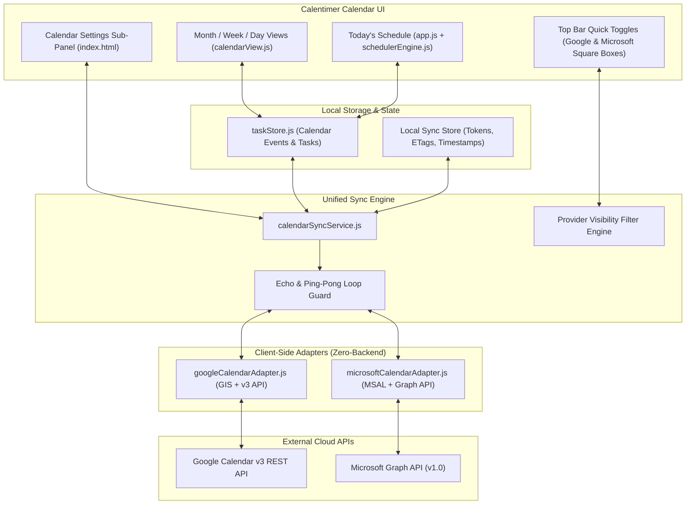

# Calentimer: Phase 3 Master Implementation Plan
## Two-Way External Calendar Sync (Google & Microsoft) + Header Quick Toggles

---

## 1. Executive Vision & User Experience

Phase 3 introduces seamless, zero-backend, two-way calendar synchronization between **Calentimer** and personal **Google Calendar** and **Microsoft Outlook / 365** accounts.

### Key UX Workflows
1. **Header Quick Toggles (Square Box Icons)**:
   - In the **Calendar View** top bar on the far right (in `.cal-sub-right`, immediately next to the `< Today >` navigation group):
     - **Google Calendar Toggle Box**: A square, sleek icon box featuring the authentic Google logo.
     - **Microsoft Calendar Toggle Box**: A square, sleek icon box featuring the authentic Microsoft logo.
   - **Toggled ON (Active)**: Subtle provider-themed glowing border (`#4285F4` for Google, `#00A4EF` for Microsoft); tasks and meetings from that provider are rendered across Month, Week, and Day views.
   - **Toggled OFF (Filtered)**: Icon becomes dimmed/translucent; events from that provider are instantly hidden from the calendar view without being deleted from local storage or cloud.
   - **Not Connected**: Tap opens the connection dialog or Settings directly.

2. **Non-Intrusive Sign-In Prompt on App Launch**:
   - When a user opens Calentimer, if neither account is connected, an optional, elegant onboarding prompt appears:
     > *"Connect your calendar to sync events with Google or Microsoft [Sign in with Google] [Sign in with Microsoft] [Not now]"*
   - Completely dismissible / optional: Calentimer remains 100% functional offline and standalone.

3. **Instant Post-Sign-In Sync Prompt**:
   - As soon as the user connects an account (Google or Microsoft), a prompt immediately asks:
     > *"Sync your calendar now? [Sync Now] [Later]"*
   - Tapping **Sync Now** triggers the initial delta import and renders events immediately on the calendar.

4. **Bi-Directional 2-Way Synchronization**:
   - **Cloud -> Calentimer**: External meetings (e.g. team calls, appointments) appear automatically in Calentimer's Month, Week, and Day views, and automatically bridge into *Today's Schedule* as padlocked fixed-time events.
   - **Calentimer -> Cloud**: Any event created, rescheduled (drag-and-drop in Day view or resize in Week view), or deleted within Calentimer immediately syncs back to the user's personal Google or Microsoft calendar.

5. **Settings Management**:
   - In **Settings -> Calendar Settings**, a new **"Connected Accounts & Sync"** section displays connection status, connected email, last synced time, manual "Sync Now" button, and "Disconnect" button.

---

## 2. Architecture & Technical Design



---

## 3. UI Specifications

### A. Calendar View Top Bar (.cal-sub-right)
In `index.html`, `#fullCalendarModal` currently has an empty `.cal-sub-right` container with `style="width: 80px; min-width: 80px;"`. We replace this with the square provider toggle button group:

```html
<div class="cal-sub-right" id="calSubRight">
  <div class="cal-provider-toggles">
    <!-- Google Calendar Toggle Box -->
    <button type="button" class="cal-provider-box-btn" id="btnToggleGoogleCal" title="Google Calendar: Click to toggle visibility or connect">
      <svg class="provider-icon google-icon" width="18" height="18" viewBox="0 0 24 24">
        <!-- Authentic Google 4-Color 'G' Icon -->
        <path fill="#4285F4" d="M22.56 12.25c0-.78-.07-1.53-.2-2.25H12v4.26h5.92c-.26 1.37-1.04 2.53-2.21 3.31v2.77h3.57c2.08-1.92 3.28-4.74 3.28-8.09z"/>
        <path fill="#34A853" d="M12 23c2.97 0 5.46-.98 7.28-2.66l-3.57-2.77c-.98.66-2.23 1.06-3.71 1.06-2.86 0-5.29-1.93-6.16-4.53H2.18v2.84C3.99 20.53 7.7 23 12 23z"/>
        <path fill="#FBBC05" d="M5.84 14.09c-.22-.66-.35-1.36-.35-2.09s.13-1.43.35-2.09V7.06H2.18C1.43 8.55 1 10.22 1 12s.43 3.45 1.18 4.94l2.85-2.22.81-.63z"/>
        <path fill="#EA4335" d="M12 5.38c1.62 0 3.06.56 4.21 1.64l3.15-3.15C17.45 2.09 14.97 1 12 1 7.7 1 3.99 3.47 2.18 7.06l3.66 2.84c.87-2.6 3.3-4.52 6.16-4.52z"/>
      </svg>
      <span class="provider-status-dot" id="googleStatusDot"></span>
    </button>

    <!-- Microsoft Outlook / 365 Toggle Box -->
    <button type="button" class="cal-provider-box-btn" id="btnToggleMicrosoftCal" title="Microsoft Calendar: Click to toggle visibility or connect">
      <svg class="provider-icon ms-icon" width="18" height="18" viewBox="0 0 24 24">
        <!-- Authentic Microsoft 4-Color Grid Icon -->
        <rect x="1" y="1" width="10" height="10" fill="#F25022"/>
        <rect x="13" y="1" width="10" height="10" fill="#7FBA00"/>
        <rect x="1" y="13" width="10" height="10" fill="#00A4EF"/>
        <rect x="13" y="13" width="10" height="10" fill="#FFB900"/>
      </svg>
      <span class="provider-status-dot" id="msStatusDot"></span>
    </button>
  </div>
</div>
```

### B. Square Toggle Button States (`style.css`)
- **Size**: 34px × 34px square with `border-radius: var(--radius-sm)` (6px).
- **Default / Unconnected**: `background: rgba(255, 255, 255, 0.05)`, border `1px solid rgba(255, 255, 255, 0.12)`, `opacity: 0.5`.
- **Connected & Active**:
  - Google: `border: 1.5px solid #4285F4`, `background: rgba(66, 133, 244, 0.15)`, `box-shadow: 0 0 8px rgba(66, 133, 244, 0.35)`, `opacity: 1`.
  - Microsoft: `border: 1.5px solid #00A4EF`, `background: rgba(0, 164, 239, 0.15)`, `box-shadow: 0 0 8px rgba(0, 164, 239, 0.35)`, `opacity: 1`.
- **Connected & Muted (Filtered Off)**:
  - `opacity: 0.35`, `border-style: dashed`, `box-shadow: none`. Diagonal indicator or dimmed badge.

### C. App Launch Sign-In Modal (`#calendarConnectModalBackdrop`)
A dedicated, unobtrusive modal rendered if user has not yet signed in:
- Header with lock/calendar icon: *"Sync with Your External Calendar"*
- Description: *"Connect your Google or Microsoft Calendar for automated two-way synchronization. Meetings appear right on your timeline."*
- Buttons:
  - `btnConnectGoogle`: "Continue with Google"
  - `btnConnectMicrosoft`: "Continue with Microsoft"
  - `btnSkipConnect`: "Not Now (Keep Local Only)"
- Checkbox: *"Don't ask again on startup"* (stored in `taskStore`).

### D. Sync Confirmation Prompt Modal (`#confirmSyncNowModalBackdrop`)
Displayed immediately after completing OAuth sign-in:
- *"Account Connected! Sync your events now?"*
- *"We will import your upcoming schedule into Calentimer."*
- `btnConfirmSyncNow`: "✓ Sync Now"
- `btnDismissSyncNow`: "Later"

---

## 4. Data Model & Storage Extensions (`taskStore.js`)

Calentimer stores calendar events in `localStorage` (`calentimer_calendar_events`). We extend the event schema cleanly:

```javascript
{
  id: "evt_1234567890",             // Calentimer unique ID
  title: "Team Architecture Review",
  date: "2026-10-28",               // YYYY-MM-DD
  startTime: "14:00",               // HH:mm
  endTime: "15:00",                 // HH:mm
  plannedDuration: 60,              // Minutes
  category: "Meeting",
  emoji: "👥",
  isLocked: true,                   // External meetings default to locked
  useTimeBank: false,

  // --- Phase 3 Sync Metadata ---
  provider: "google",               // "local" | "google" | "microsoft"
  externalId: "gcal_abc123xyz",     // Unique ID from Google Calendar v3 or MS Graph
  externalCalendarId: "primary",    // "primary" or calendar ID
  etag: "\"3345892301\"",           // ETag from cloud provider
  syncHash: "a1b2c3d4",             // Local hash of (title + date + startTime + endTime)
  lastSyncedAt: 1793172000000,      // Timestamp of last sync
  isDirty: false                    // Flag for offline pending changes
}
```

### New Settings in `taskStore.js`:
- `taskStore.getGoogleCalendarConnected()` / `setGoogleCalendarConnected(bool)`
- `taskStore.getMicrosoftCalendarConnected()` / `setMicrosoftCalendarConnected(bool)`
- `taskStore.getGoogleCalendarVisible()` / `setGoogleCalendarVisible(bool)` (Default: `true`)
- `taskStore.getMicrosoftCalendarVisible()` / `setMicrosoftCalendarVisible(bool)` (Default: `true`)
- `taskStore.getGoogleSyncToken()` / `setGoogleSyncToken(token)`
- `taskStore.getMicrosoftDeltaLink()` / `setMicrosoftDeltaLink(link)`
- `taskStore.getAutoSyncEnabled()` / `setAutoSyncEnabled(bool)` (Default: `true`)
- `taskStore.getLastSyncTimestamp(provider)` / `setLastSyncTimestamp(provider, ts)`

---

## 5. Unified Sync Service (`calendarSyncService.js`)

The `CalendarSyncService` class coordinates adapters, local storage, UI notifications, and conflict guards.

```javascript
class CalendarSyncService {
  constructor() {
    this.adapters = {
      google: null,     // GoogleCalendarAdapter instance
      microsoft: null   // MicrosoftCalendarAdapter instance
    };
    this.isSyncing = false;
    this.syncListeners = new Set();
  }

  // 1. Provider Connection & Authentication
  async connectProvider(provider) // "google" or "microsoft"
  async disconnectProvider(provider)
  isProviderConnected(provider)

  // 2. Visibility Filtering
  toggleProviderVisibility(provider)
  isProviderVisible(provider)

  // 3. Bidirectional Sync Operations
  async syncAll()                   // Runs delta sync for all connected & active providers
  async syncProvider(provider)      // Pulls deltas, resolves conflicts, pushes dirty items
  async pushEventCreate(event)      // Outbound create to connected provider
  async pushEventUpdate(event)      // Outbound update to connected provider
  async pushEventDelete(eventId)    // Outbound delete to connected provider

  // 4. Lifecycle & Auto-Sync
  startAutoSync()                   // Binds visibilitychange and 60s background delta poll
  stopAutoSync()
}
```

---

## 6. Adapter Implementation Details

### A. Google Calendar Adapter (`googleCalendarAdapter.js`)
- **Authentication**: Native **Google Identity Services (GIS)** token client.
  - Script: Loaded asynchronously from `https://accounts.google.com/gsi/client`.
  - Scope: `https://www.googleapis.com/auth/calendar.events` (events read & write).
  - Pure client-side PKCE token flow: No client secret needed.
- **REST Endpoints**:
  - `GET https://www.googleapis.com/calendar/v3/calendars/primary/events`
    - Full fetch: `timeMin`, `timeMax` (covering active calendar window: e.g. -30 days to +60 days).
    - Incremental fetch: `syncToken={token}` (returns only created, updated, and deleted events).
  - `POST https://www.googleapis.com/calendar/v3/calendars/primary/events` (Outbound create).
  - `PATCH https://www.googleapis.com/calendar/v3/calendars/primary/events/{id}` (Outbound edit).
  - `DELETE https://www.googleapis.com/calendar/v3/calendars/primary/events/{id}` (Outbound delete).

### B. Microsoft Calendar Adapter (`microsoftCalendarAdapter.js`)
- **Authentication**: **Microsoft Authentication Library (MSAL Browser)**.
  - Script: Bundled or CDN `https://alcdn.msauth.net/browser/2.38.0/js/msal-browser.min.js`.
  - Scopes: `Calendars.ReadWrite`, `User.Read`.
  - Redirect URI: Window origin (e.g. `http://localhost:3000/` or `https://calentimer.com/`).
- **Graph Endpoints**:
  - `GET https://graph.microsoft.com/v1.0/me/calendarView/delta?startDateTime=...&endDateTime=...`
    - Returns initial events + `@odata.deltaLink` for future 1-request delta updates.
  - `POST https://graph.microsoft.com/v1.0/me/events` (Outbound create).
  - `PATCH https://graph.microsoft.com/v1.0/me/events/{id}` (Outbound edit).
  - `DELETE https://graph.microsoft.com/v1.0/me/events/{id}` (Outbound delete).

---

## 7. Echo Loop & Ping-Pong Prevention

A classic issue in two-way calendar sync is the **"echo loop"**:
1. User changes an event time in Calentimer.
2. Calentimer calls external API `PATCH`.
3. External API updates the event and generates a new sync delta.
4. Next inbound poll receives this delta and re-imports the event as an external change, potentially re-triggering notifications or dirty state.

### Guard Strategy:
- **Hash Signature**: When Calentimer performs an outbound update, it computes `syncHash = hash(title + date + startTime + endTime + isLocked)` and saves it in `taskStore` alongside `etag`.
- **Inbound Filter**: When delta returns an event whose `syncHash` matches our stored `syncHash`, it is recognized as our own emitted update and silently reconciled without prompting or re-rendering unnecessarily.

---

## 8. Integration with Today's Schedule & Timer

1. **Automatic Today Extraction**:
   - When external events are synced into Calentimer, any events with `date === todayISO` are automatically bridged into *Today's Schedule* via `taskStore.syncScheduleAndCalendar()`.
2. **Locked by Default**:
   - Meetings imported from Google or Microsoft are automatically assigned `isLocked: true`, preserving their exact wall-clock start and end times.
3. **Dynamic Buffer Cushioning**:
   - `schedulerEngine.js` treats locked calendar meetings as immovable anchor points.
   - User tasks (study, practice, coding) automatically compress or expand to fit neatly between meetings before the user's Hard Stop deadline.

---

## 9. Phased Execution Roadmap for the Next Conversation

When opening the new conversation, the implementation proceeds in clear, atomic steps:

```
[Phase 3 Implementation Roadmap]
  │
  ├── Step 1: UI Shell & Top Bar Toggles
  │   ├── Add Google & Microsoft square box buttons to index.html in .cal-sub-right
  │   ├── Add styles for active, glowing, dimmed, and unconnected states in style.css
  │   ├── Add Onboarding Sign-In Modal & "Sync Now?" confirmation modal in index.html
  │   └── Add Connected Accounts section to #calendarSettingsSubPanel
  │
  ├── Step 2: Storage & State Foundations
  │   ├── Extend taskStore.js with provider metadata, visibility toggles, and sync tokens
  │   ├── Update calendarView.js to filter rendered events by active provider toggles
  │   └── Add unit tests for provider visibility filtering (testCalendarView.js)
  │
  ├── Step 3: Google Calendar Adapter
  │   ├── Implement googleCalendarAdapter.js (GIS authentication + v3 REST API)
  │   ├── Outbound CRUD (create, update, delete) + Inbound syncToken delta pull
  │   └── Event mapping between Google schema and Calentimer schema
  │
  ├── Step 4: Microsoft Calendar Adapter
  │   ├── Implement microsoftCalendarAdapter.js (MSAL Browser + Graph delta API)
  │   ├── Outbound CRUD + Inbound deltaLink pull
  │   └── Event mapping between Outlook schema and Calentimer schema
  │
  ├── Step 5: Unified CalendarSyncService & Echo Guard
  │   ├── Implement calendarSyncService.js
  │   ├── Wire lifecycle auto-sync (visibilitychange + 60s background timer)
  │   ├── Implement syncHash echo suppression
  │   └── Wire into app.js event listeners (event creation, drag move, duration resize)
  │
  └── Step 6: Master Test Suite & Verification
      ├── Add testCalendarSyncService.js to testAll.js
      ├── Verify zero ?. and zero ?? in all new code (testSyntaxCompatibility.js)
      └── Run full suite (node testAll.js) and push to GitHub
```

---

## 10. Strict Development & Compatibility Invariants

1. **Zero Optional Chaining (`?.`) or Nullish Coalescing (`??`)**:
   - Strictly forbidden across all JavaScript files.
   - Always use explicit boolean checks (`obj && obj.prop`, `typeof x !== 'undefined' ? x : default`).
2. **Zero Shell Code Inspection**:
   - All inspection strictly performed using built-in `read_file`.
   - Shell commands strictly reserved for `node testAll.js`, dev server, and git.
3. **Local-First Resilience**:
   - If the user is offline or chooses not to connect accounts, the entire calendar, schedule, and timer experience functions 100% locally with zero errors or degraded features.
4. **Preserve Documentation**:
   - Maintain existing docstrings and structure across all modified files.
